# Anthony Abah · `UncleT-cyber`

### Full-stack developer building practical products for the web

I enjoy taking ideas from concept to launch—combining thoughtful product design, modern web technologies, and a security-minded approach.

---

## Selected work

A few products and projects I’m focused on. Visit the live sites or explore the public source code.

<table>
  <tr>
    <td width="50%" valign="top">
      <h3><a href="https://landlordport.com">LandlordPort ↗</a></h3>
      
A property platform designed to support landlord workflows across multiple jurisdictions.

      
       Source repository is private.
    </td>
    <td width="50%" valign="top">
      <h3><a href="https://zumamart.app">ZumaMart ↗</a></h3>
      
An online marketplace experience built to make discovering and shopping for products easy.

      
       Source repository is private.
    </td>
  </tr>
  <tr>
    <td width="50%" valign="top">
      <h3><a href="https://github.com/UncleT-cyber/mivapulse">MIVAPULSE ↗</a></h3>
      
A JavaScript project. Explore the repository for its implementation and latest details.

      
      
    </td>
    <td width="50%" valign="top">
      <h3><a href="https://github.com/UncleT-cyber/libria">Libria ↗</a></h3>
      
A multi-language project built with TypeScript, Python, and Rust.

      
      
    </td>
  </tr>
</table>

---

## Tools I work with

**Languages**  

**Frameworks, platforms & databases**  

---

> “The future is already here — it's just not evenly distributed.” — **William Gibson**

**Stay safe. Stay ethical. Keep building.**

